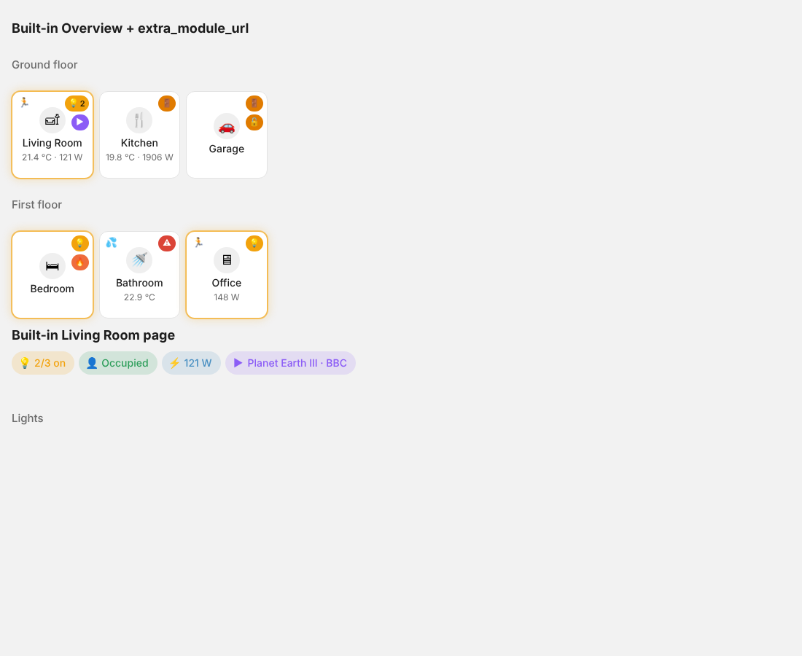

# Overview Extras

This adds richer room cards to Home Assistant's **built-in Overview**. You don't need a new dashboard or any YAML.

It doesn't replace or copy the Overview. Home Assistant still builds its own Overview as normal, and this adds extras on top. When Home Assistant updates the Overview, you get those updates automatically.

## What it adds

| On each room card | How it shows |
|---|---|
| Lights on | An amber glow around the card, plus a 💡 badge with a count. Tap the badge to turn the room's lights off. |
| Presence | The card's presence icon also reacts to `occupancy` and `presence` sensors, not just `motion`. |
| Total room power | The summed power of the room's `power` sensors, on the card's sensor line. |
| Open doors, windows or garage | 🚪 badge with a count. |
| Unlocked locks | 🔓 badge. |
| Media playing | ▶ badge. Tap it for the player. |
| Heating or cooling | 🔥 or ❄ badge. |
| Leak, smoke, gas or CO | Red ⚠ badge. |

Each **room page** also gets a status strip at the top. For example: "2/3 on · Occupied (or Clear · 12m ago) · 186 W · → 20° · Window · Planet Earth III · ⚠ Leak · 🪫 1".

Everything populates from your areas, devices and entities. An entity belongs to a room if it, or its device, is assigned to that area. Hidden, diagnostic and config entities are ignored.

## Install

1. In HACS, open ⋮ → **Custom repositories**. Add `https://github.com/GarbledMess/ha-overview-extras` with type **Integration**.
2. Install **Overview Extras** and restart Home Assistant.
3. Go to Settings → Devices & services → **Add integration** → **Overview Extras** → Submit.
4. Refresh your browser and the mobile app.

To remove it, delete the integration under Devices & services.

## Settings

Go to Settings → Devices & services → Overview Extras → **Configure**:

- Glow room cards when lights are on
- Show total room power
- Use occupancy and presence sensors for the presence icon
- Status strip at the top of room pages
- Which badges to show, and the maximum per card (room tiles are small, so the default is 3)
- **Power sensors to leave out of room totals.** Use this to stop double counting, for example a circuit meter plus the plugs on that circuit.
- Entities to ignore completely

After changing settings, refresh the browser or app.

## Extras for custom dashboards

Once installed, these are also available everywhere:

- `strategy: type: custom:overview-extras`: a separate dashboard that is the built-in Overview plus extras. It's also listed under Add dashboard → Community dashboards on HA 2026.5 and later.
- `strategy: type: custom:enhanced-areas`: a fully self-contained area dashboard that doesn't depend on HA internals. It includes a whole-home summary, floors of large room cards, a page per room, and unassigned entities.
- Cards: `custom:enhanced-area-card` (with `area:`) and `custom:enhanced-home-summary-card`.

## How it works

- The integration serves `overview-extras.js` and registers it as a frontend extra module. That means it loads on every page, including the built-in Overview, which never loads dashboard resources. Your settings are passed in the module's URL.
- The Overview is built by HA's `home` strategies. The module hooks HA's `home-overview` and `home-area` view strategies as they load, and post-processes their output:
  - Each built-in `area` card is wrapped by `enhanced-area-card`. The wrapper renders the **real built-in card**, with power added to its sensor classes and occupancy and presence added to its alert classes, plus the badge overlay and glow.
  - Room pages get the status strip.
- If a future HA release renames those internals, nothing is changed and you get the plain Overview. It never breaks it.

Tested against Home Assistant 2026.2. The integration tests run against HA 2026.2.3, and the frontend was checked against build 20260128.

## Development

- `tests/`: pytest-homeassistant-custom-component tests for setup, injection into the page, the options flow and unload. Run them with `pytest`.
- `test/harness.html`: a mock HA for the frontend. Open it via a local web server with `?mode=global|injected|area|standalone`.
